
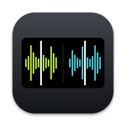

<h1 align="center">Earmatch</h1>

Practise beatmatching by ear on rekordbox 7. Free for Mac and Windows.

  <a href="https://github.com/GastonDalla/earmatch/releases/latest"><b>Download</b></a> ·
  <a href="https://earmatch.gastondalla.com">Website</a> ·
  <a href="docs/GUIDE.md">Guide</a>

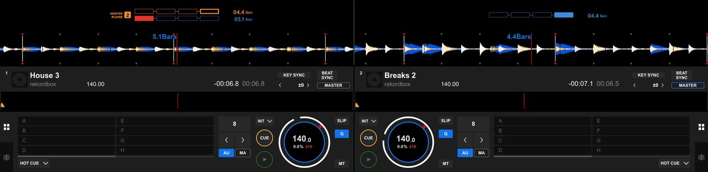

## What it does

- **Hides what you would match by eye:** the decimals of the jog BPM (or all of it) and the stacked waveforms, split per deck or hidden.
- **Adds a Pioneer-style phase meter** when you want a check: CDJ-2000NXS boxes, the NXS2 line, or the CDJ-3000 meter or waveform, with a bar counter or a cue countdown.
- **Times every mix** with the mix trainer and keeps your practice history.
- **Peek:** hold a key to see rekordbox unchanged.

Earmatch only reads rekordbox. It never clicks, types into or controls it.

<b>See every mode in rekordbox</b>

**rekordbox alone**, for comparison

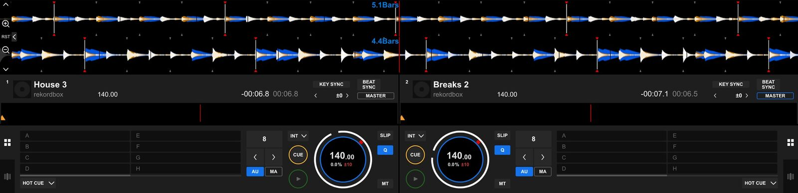

**Type 2 · Line** phase meter (CDJ-2000NXS2, XDJ-1000MK2)

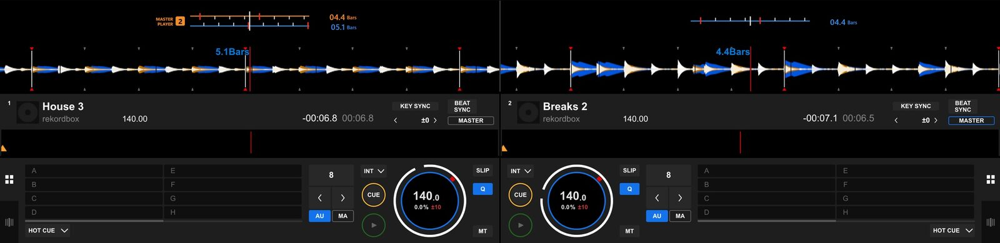

**CDJ-3000 · Meter**

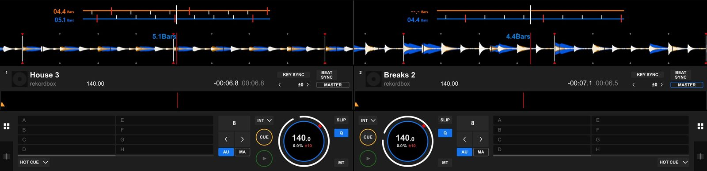

**CDJ-3000 · Wave**: the master deck's waveform above yours

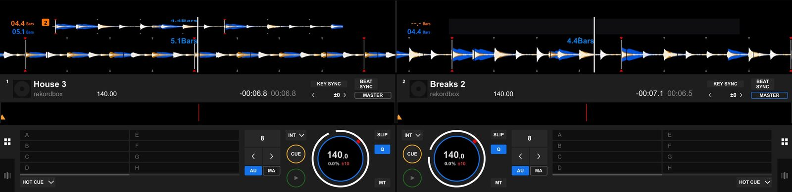

**Hide Both**: only the meters stay

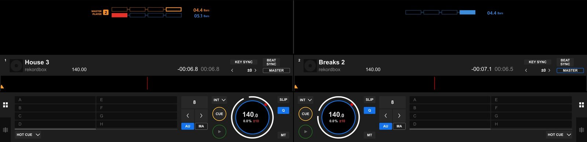

**Full blind mode**: also covers the pitch and the track BPM in the deck header

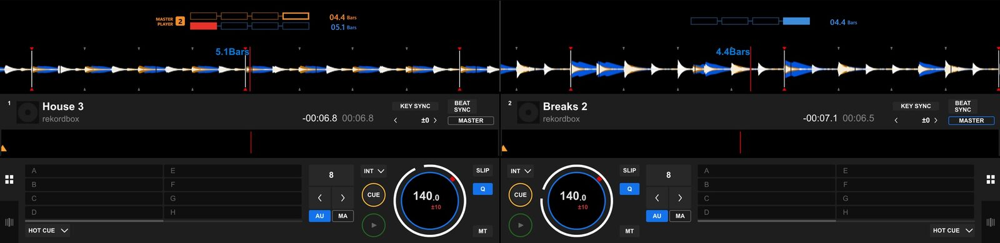

**Jog BPM**: rekordbox alone, One decimal, No decimals, Cover fully and Full blind mode

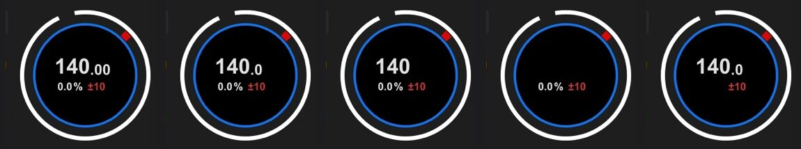

## Install

| | Mac | Windows |
| --- | --- | --- |
| Needs | macOS 14 or later, Apple silicon or Intel | Windows 10 (2004 or later) or 11, x64 or Arm64 |
| Download | `Earmatch-<version>.dmg` | `Earmatch-win-x64-Setup.exe` (Windows on Arm: `-arm64-`) |
| First run | Drag Earmatch to Applications, open it and allow **Accessibility** and **Screen Recording** | Run the installer. Until it is signed, SmartScreen asks: **More info** › **Run anyway** |

Both use rekordbox 7 in **PERFORMANCE** mode with a 2Deck or 4Deck layout, and update themselves.

## Hotkeys

| Mac | Windows | Action |
| --- | --- | --- |
| Hold **Right Option** | Hold **Right Alt** | Peek at rekordbox unchanged |
| **⌃⌥⌘E** | **Ctrl+Alt+Win+E** | Turn Earmatch on or off |
| **⌘1**–**⌘4** | **Ctrl+1**–**Ctrl+4** | Live, Overlay, Practice, Setup |

  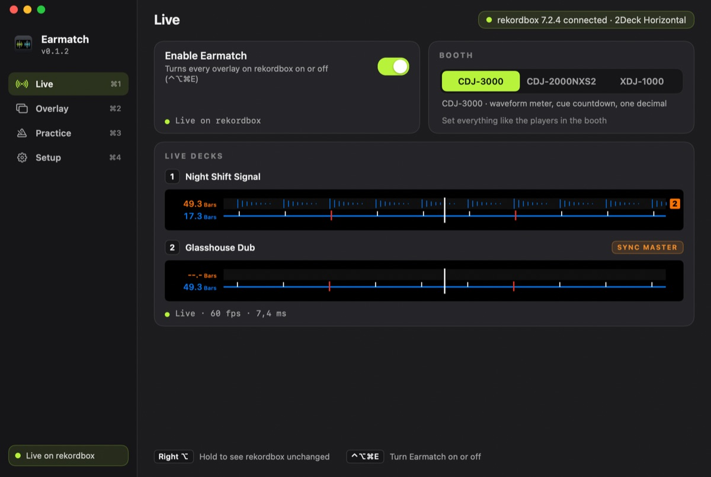
  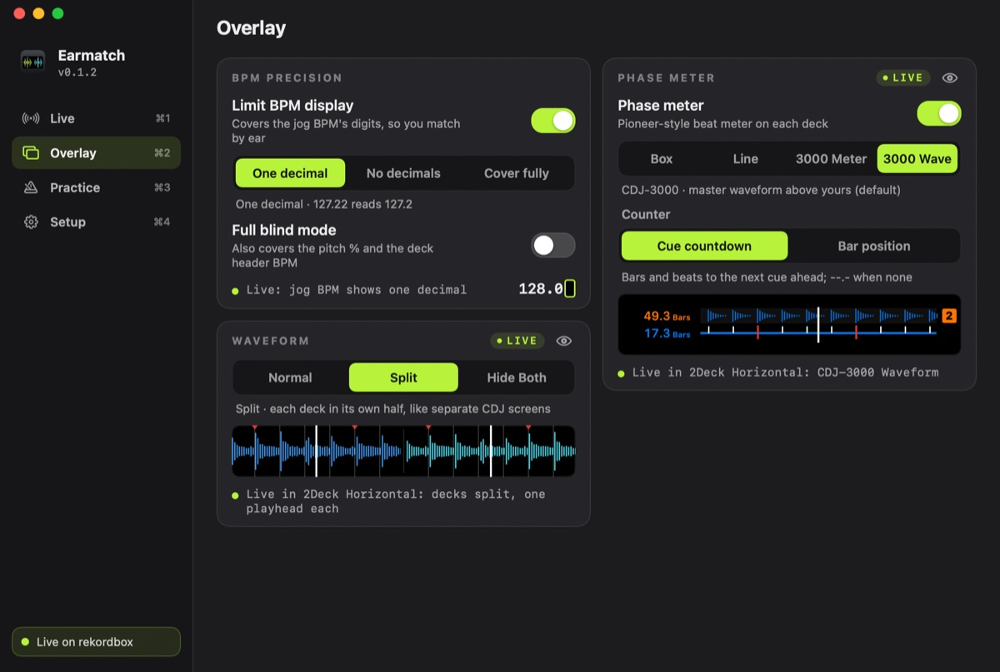
  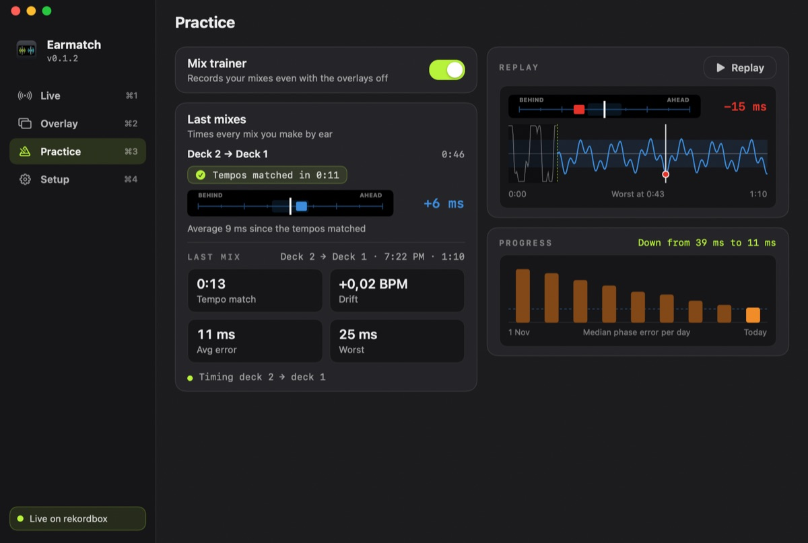

## Privacy

Earmatch reads only the rekordbox window. Frames stay in memory and are never saved or sent anywhere. It goes online only to check for updates.

## Build

- Mac: `./scripts/build-app.sh`, tests with `swift test`.
- Windows: `dotnet build windows/Earmatch.slnx`, tests with `dotnet test windows/Earmatch.slnx`.
- Releases: [docs/RELEASING.md](docs/RELEASING.md). Everything else: [docs/GUIDE.md](docs/GUIDE.md).

## Credits

Made by [GastonDalla](https://github.com/GastonDalla). Independent utility, not affiliated with AlphaTheta, Pioneer DJ or rekordbox. rekordbox, Pioneer DJ, CDJ and XDJ are trademarks of their respective owners.
